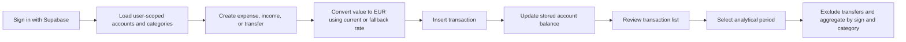
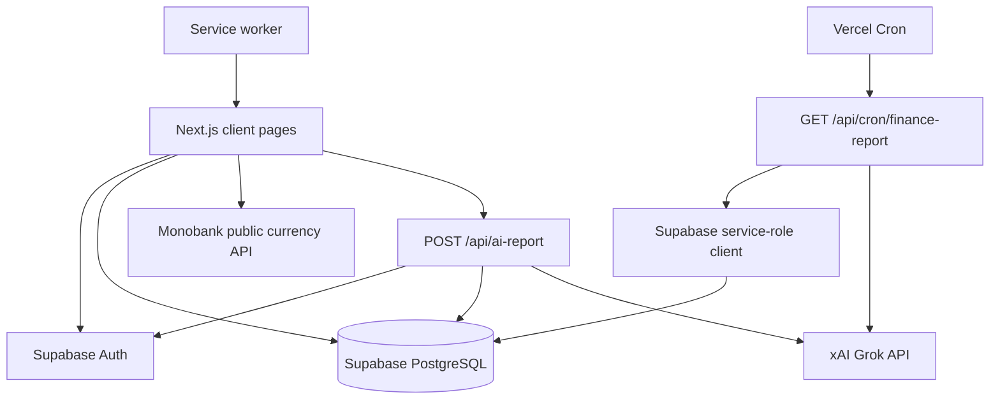
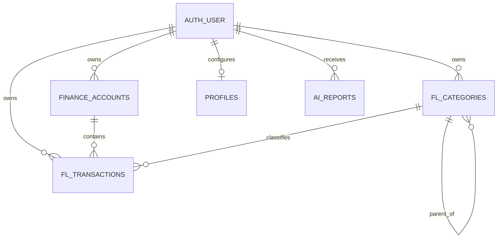

# FlowLedger

**Personal Finance Management & Analytics | Product Analytics Case Study**

## 1. Project Overview

FlowLedger is an independently developed personal-finance MVP for recording accounts and transactions, classifying income and expenses, and reviewing spending by period and category. It is designed for an individual who wants one place to maintain balances across EUR, UAH, and USD accounts and analyze the resulting ledger in EUR.

The project addresses a common data problem: financial activity is distributed across accounts and currencies, while useful analysis requires consistent categories, time periods, and conversion rules. FlowLedger combines transaction management, a mobile-first analytics view, JSON export, and optional AI-generated weekly commentary.

FlowLedger is part of the broader T6X personal-productivity concept. This repository is an MVP and portfolio case, not a banking product, financial-advice service, or production-grade accounting system.

## 2. Live Demo

[https://flow-ledger-teal.vercel.app](https://flow-ledger-teal.vercel.app)

The deployment was checked on 9 October 2026 and successfully displayed the FlowLedger sign-in page. Access to authenticated features requires an existing Supabase account; public registration and demo credentials are not provided.

## 3. My Role

I worked independently as product owner and developer. The work represented by this repository includes:

- defining the personal-finance problem and MVP scope;
- translating the concept into user workflows and functional behavior;
- modelling accounts, hierarchical categories, transactions, and AI reports;
- implementing a mobile-first Next.js application and Supabase integration;
- designing EUR-normalized financial calculations and category analysis;
- integrating Monobank exchange rates and the xAI/Grok API;
- documenting product assumptions, requirements, data logic, risks, and improvement opportunities;
- using AI-assisted development as an implementation aid, with the resulting behavior verified against the source code.

This project does not represent commercial product ownership, customer research, team leadership, or validated market traction.

## 4. Business Problem

Personal financial data can be fragmented across cash and bank accounts, recorded in different currencies, and labelled inconsistently. This makes it difficult to answer basic questions such as how much was spent in a period, which categories drive spending, and whether account balances reflect recorded activity.

An effective solution needs both operational workflows—adding and maintaining transactions—and an analytical layer with explicit rules for signs, transfers, currencies, categories, and date boundaries.

## 5. Proposed Solution

FlowLedger provides a single-user workspace where authenticated users can maintain accounts, record expenses, income, and transfers, organize them with categories and subcategories, and view day, week, month, or year summaries. Monetary values are retained in their account currency and, when created, normalized to EUR for analytics. Optional Grok reports summarize recent expense totals by category.

## 6. Key Features

| Feature | Implemented behavior | Limitations |
|---|---|---|
| Email/password sign-in | Uses Supabase password authentication and redirects unauthenticated page visitors to `/login`. | No sign-up, password reset, middleware, or repository-visible RLS policies. Page protection is client-side. |
| Accounts | Create, edit, delete, mark as savings, choose EUR/UAH/USD, set a stored balance, and include/exclude an account from the home total. | Balances are stored values rather than ledger-derived values. Writes depend on unverified RLS. |
| Transactions | Create manual expenses, income, and two-leg transfers; inspect, edit, delete, paginate, filter, and sort records. | Database writes and balance changes are separate and non-atomic. Transfer legs are not linked. |
| Categories | Seed defaults, create/delete expense or income categories, and maintain one level of subcategories. | Referential behavior on deletion is not verifiable without the database schema. |
| Multi-currency handling | Fetches Monobank EUR/UAH and USD/UAH rates, caches them for one hour, and stores `amount_eur` when a transaction is created. | Hard-coded rates are used after fetch failure. Rate source/time is not stored. Cross-currency transfers are not converted for the target account. |
| Analytics | Calculates income, expenses, category shares, and subcategory shares for day/week/month/year periods; transfers are excluded. | Uncategorized expenses are included in total spend but omitted from the category chart. No trend series or net-cash-flow visualization. |
| Transaction filtering | Filters loaded records by type and current week/month and sorts by date or absolute amount. | Filtering occurs after pagination and therefore does not cover records that have not been loaded. |
| JSON export | Downloads a flattened, user-scoped transaction dataset with category and account names. | No CSV/Excel export or import. Account/category master records are not exported separately. |
| AI weekly report | Authenticated users can generate a Grok report; a protected Vercel cron route processes enabled profiles weekly and stores reports. | User API keys are stored in `profiles`; push delivery mentioned in the UI is not implemented. No timeout, usage limit, or financial-advice disclaimer. |
| PWA shell | Includes a manifest, icons, service-worker registration, and a small pre-cache. | Supabase and Monobank are network-only; authenticated finance workflows are not verified offline. |
| Budgets | A TypeScript `FLBudget` interface exists. | No budget query, UI, calculation, or schema migration is present. |
| Historical import | Transaction `source` can distinguish values such as `manual` and `excel`. | No Excel, CSV, or other import workflow exists in the repository. |

## 7. Business Analysis & Product Documentation

| Document | Portfolio focus |
|---|---|
| [Business Case](docs/BUSINESS_CASE.md) | Problem framing, stakeholders, scope, assumptions, dependencies, risks, and proposed outcomes |
| [Functional Requirements](docs/FUNCTIONAL_REQUIREMENTS.md) | Traceable implemented behavior, acceptance criteria, non-functional requirements, and gaps |
| [User Workflows](docs/USER_WORKFLOWS.md) | Verified journeys, alternatives, errors, and implementation evidence |
| [System Overview](docs/SYSTEM_OVERVIEW.md) | Architecture, inferred data model, APIs, authentication boundaries, and deployment |
| [Data Analysis](docs/DATA_ANALYSIS.md) | Metric definitions, aggregation logic, currency treatment, quality risks, and limitations |
| [Product Metrics](docs/PRODUCT_METRICS.md) | Proposed KPI framework, funnel, events, experiments, and tracking gaps |

## 8. Core User Workflows



Transaction insertion and balance updates are separate requests. The diagram describes the implemented sequence, not an atomic database transaction.

## 9. System Architecture



Most application data access occurs directly from browser-created Supabase clients. The repository does not contain SQL migrations or policies, so PostgreSQL constraints and Row Level Security cannot be verified.

## 10. Data Model

The model below is inferred from TypeScript interfaces and Supabase queries, not from a checked-in database schema.



Verified query targets are `finance_accounts`, `fl_categories`, `fl_transactions`, `profiles`, and `ai_reports`. `fl_budgets` appears only as a TypeScript interface and is therefore unverified as a deployed table.

## 11. Financial Analytics

For a selected date interval, analytics load non-transfer transactions and classify records by amount sign:

- expense: `amount < 0`;
- income: `amount > 0`;
- EUR analytical value: `abs(amount_eur ?? converted amount)`;
- total spent: sum of analytical values for expenses;
- total income: sum of analytical values for income;
- category share: category expense total divided by the total of categorized expenses;
- subcategory share: subcategory expense total divided by the selected category total.

Important caveats include fallback exchange rates, locally evaluated date ranges, stale `amount_eur` after transaction edits, and exclusion of uncategorized expenses from chart breakdowns. See [Data Analysis](docs/DATA_ANALYSIS.md).

## 12. Technology Stack

| Area | Verified technology |
|---|---|
| Application | Next.js 14 App Router, React 18, TypeScript |
| UI | Tailwind CSS, Base UI, Lucide React, custom SVG donut chart |
| Authentication/data | Supabase SSR/browser clients and Supabase Auth; PostgreSQL is provided by Supabase but schema files are absent |
| Currency | Monobank public currency endpoint with local fallback values |
| AI | xAI chat-completions API using `grok-3-mini` |
| Scheduling/deployment | Vercel deployment and cron configuration |
| PWA | Web app manifest, icons, and service worker |

## 13. Local Setup

Prerequisites: Node.js 18.17 or later, npm, an existing Supabase project with the inferred tables, and at least one password-authenticated user.

```bash
npm install
cp .env.example .env.local
npm run dev
```

Open `http://localhost:3000`. Configure credentials with placeholders only:

```dotenv
NEXT_PUBLIC_SUPABASE_URL=https://your-project.supabase.co
NEXT_PUBLIC_SUPABASE_ANON_KEY=your-anon-key
SUPABASE_SERVICE_ROLE_KEY=your-server-only-service-role-key
CRON_SECRET=your-random-cron-secret
```

The service-role key must remain server-only. A Grok key is entered per user in Settings and stored in the `profiles` table. The repository does not include schema migrations or seed scripts, so local database provisioning requires external setup.

## 14. Security and Privacy

Implemented safeguards include Supabase session validation in the manual report API, bearer-secret validation on the cron endpoint, server-only use of `SUPABASE_SERVICE_ROLE_KEY`, ignored local environment files, and user-id filters on read queries.

Limitations:

- RLS policies, grants, constraints, and indexes are absent and unverified.
- Many browser-side updates and deletes filter only by record ID; safe tenant isolation therefore depends on correctly deployed RLS.
- Authenticated pages rely on client-side redirects rather than middleware or server guards.
- The Grok API key is stored in the database and returned to the authenticated browser settings page.
- The cron route bypasses RLS with the service role and processes all enabled profiles.
- Financial aggregates are sent to xAI when a report is generated.
- No rate limiting, audit log, explicit CSRF/origin control, data-retention workflow, or account deletion/export-completeness guarantee is implemented.

No committed environment file, private key, or common credential signature was found in the current tree or reachable Git history during the documented review.

## 15. Known Limitations

- No repository-managed schema or verified RLS policies.
- No public registration, password recovery, or demo dataset.
- No Excel/CSV import, budget management, receipt upload, push notifications, or complete offline workflow.
- Account balances can diverge from the transaction ledger because related writes are not atomic.
- Editing a transaction does not recalculate `amount_eur`.
- Transfer legs have no shared identifier; edits and deletions affect one record at a time.
- Cross-currency transfers reuse the source amount and currency for the target record.
- AI reporting covers a date window based on server time and treats missing `amount_eur` as if the original amount were EUR.
- The unused `lib/hooks/useCurrency.ts` references a missing type and a missing `/api/currency` endpoint.

## 16. Future Improvements

1. Add versioned Supabase migrations, constraints, indexes, and tested RLS policies.
2. Move financial mutations to validated server-side transactions or database functions.
3. Link transfer legs and support explicit source/target amounts and exchange rates.
4. Recalculate normalized values after edits and retain rate provenance.
5. Implement validated import with duplicate detection and reconciliation.
6. Add budgets only after defining period, rollover, and currency rules.
7. Add product-event instrumentation and data-quality monitoring.
8. Encrypt or externally manage AI credentials and add provider-consent controls.
9. Add unit, integration, RLS, and end-to-end tests.
10. Provide a non-sensitive demo account and genuine screenshots.

## 17. Repository Structure

```text
app/
  (tabs)/                 Authenticated client views: home, add, transactions, analytics, settings
  api/                    Manual and scheduled AI-report endpoints
  login/                  Supabase password sign-in
components/               Charts, navigation, sheets, and UI primitives
lib/
  supabase/               Browser and server Supabase clients
  ai-report.ts            Weekly aggregation and Grok request
  monobank.ts             Currency rates and EUR conversion
  types/                  Inferred application entities
public/                   PWA manifest, icons, and service worker
docs/                     Business, product, data, workflow, and system documentation
```

The `extracted/` directory contains reference UI fragments and is not wired into the active routes.

## 18. Verification Status

Verification performed after the documentation update:

- `npm run build` — passed; Next.js compiled the production application and completed its configured type validation. Linting is explicitly skipped during the build.
- `./node_modules/.bin/tsc --noEmit` — passed for the configured TypeScript project. `tsconfig.json` excludes `extracted` and `lib/hooks`, so the unused incomplete currency hook is outside this check.
- `npm run lint` — did not run a lint analysis because no ESLint configuration exists; `next lint` opened its interactive setup prompt and exited unsuccessfully in the non-interactive check.
- tests — not run because no test script or test files are configured.
- Markdown — all six linked documents exist; `git diff --check` passed and code fences were balanced. Mermaid source was reviewed, but no Mermaid CLI/parser is installed.
- live deployment — the sign-in page rendered successfully on 9 October 2026.
- secret scan — no tracked secret signatures or environment files were found in the current tree or reachable Git history.
- database schema/RLS — unverified because no migrations or SQL policies are included.
- screenshots — not added because authenticated demo data and credentials were not available.
