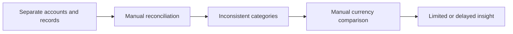
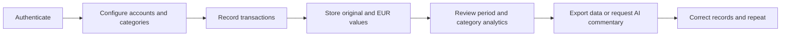

# Business Case

## 1. Executive Summary

FlowLedger is a personal-finance management MVP that combines transaction recording with EUR-normalized analysis. The implementation supports authenticated account management, hierarchical categorization, manual income/expense/transfer entry, period analysis, JSON export, and optional Grok-generated weekly commentary.

The business case is analytical rather than commercially validated. The repository contains no customer interviews, adoption data, revenue, or measured financial outcomes. Statements labelled **Observed** are grounded in code; statements labelled **Assumption** or **Proposed** are analytical recommendations.

## 2. Business Context

People may hold money across bank accounts, cash, savings, and multiple currencies. Without a common classification and reporting method, records are difficult to compare and patterns are hard to interpret.

**Observed:** FlowLedger is optimized for one authenticated person's records and supports EUR, UAH, and USD accounts. It uses EUR as the analytical currency.

**Assumption:** A target user is willing to maintain or import sufficiently complete data in exchange for clearer spending visibility.

## 3. Problem Statement

Users need a consistent way to:

- consolidate account balances;
- record financial activity with clear income/expense/transfer semantics;
- normalize values across currencies;
- classify expenses consistently;
- compare activity across time periods;
- export their records and interpret recent spending.

The quality of any insight depends on ledger completeness, category quality, exchange-rate handling, and consistent balance updates.

## 4. Target Users

**Proposed primary user:** an individual managing several personal accounts or currencies who wants lightweight, mobile-first tracking.

The repository does not demonstrate household collaboration, accountant access, bank synchronization, or business bookkeeping.

## 5. Stakeholder Analysis

| Stakeholder | Interest | Influence | Key concern |
|---|---|---:|---|
| End user | Accurate records and useful analysis | High | Privacy, effort, correctness, portability |
| Product owner/developer | Deliver a coherent and maintainable MVP | High | Scope, data rules, reliability |
| Supabase | Authentication and data platform | High | Correct configuration and RLS |
| xAI | Generates report text | Medium | Data sent to provider, availability, cost |
| Monobank public API | Supplies currency rates | Medium | Availability and rate semantics |
| Vercel | Hosts app and schedules cron | Medium | Environment configuration and execution limits |

## 6. Current Process (As-Is)

**Analytical assumption:** without a consolidated tool, a user may review balances separately, manually combine currencies, and categorize spending inconsistently across notes or spreadsheets. This process is not validated by research in the repository.

## 7. Proposed Process (To-Be)

This is the intended product process. The current MVP does not import bank files, automatically reconcile records, or guarantee atomic ledger updates.

## 8. Business Objectives

Proposed objectives are to:

1. reduce friction when recording personal transactions;
2. create a consistent analytical currency;
3. make category and time-period comparisons understandable;
4. preserve user access to exportable records;
5. test whether concise AI commentary adds value beyond descriptive analytics.

## 9. Product Value Proposition

FlowLedger combines lightweight daily entry with transparent descriptive analytics in one mobile-first interface. Its differentiator within the MVP is not automated banking; it is the combination of user-defined accounts/categories, EUR normalization, period navigation, category drill-down, and optional commentary.

## 10. MVP Scope

### Observed in scope

- Supabase password sign-in for existing users;
- EUR, UAH, and USD account records with stored balances;
- manual expense, income, and transfer entry;
- root categories and one-level subcategories;
- transaction list, pagination, filters, editing, and deletion;
- daily, weekly, monthly, and yearly income/expense analysis;
- category and subcategory expense breakdowns;
- JSON transaction export;
- on-demand and scheduled Grok reports;
- PWA metadata and minimal asset caching.

## 11. Out of Scope

The implementation does not contain:

- bank account synchronization;
- Excel/CSV import;
- budget workflows;
- shared accounts or organization roles;
- double-entry accounting or reconciliation;
- tax, investment, debt, or forecasting modules;
- push-notification delivery;
- verified offline transaction access;
- financial advice or regulated services.

## 12. Assumptions

| Assumption | Impact if false | Validation approach |
|---|---|---|
| Users will record transactions consistently. | Analytics become incomplete. | Measure active-day coverage and import demand. |
| EUR is an acceptable reporting currency. | Summaries are less relevant to some users. | Offer configurable base currency and measure adoption. |
| Category-level analysis supports decisions. | Charts may be viewed but not acted upon. | User interviews and follow-up actions. |
| Manual API-key configuration is acceptable to early users. | AI feature activation remains low. | Funnel analysis and usability testing. |
| Stored balances can be maintained accurately. | Home total loses trust. | Reconciliation checks against ledger-derived balances. |

## 13. Dependencies

- Supabase Auth and database availability;
- correct, unverified database schema and RLS policies;
- Monobank currency endpoint or hard-coded fallback rates;
- xAI API availability and user-provided key;
- Vercel environment variables and cron scheduler;
- current browser features for local storage, service workers, vibration, and downloads.

## 14. Risks

| Risk | Type | Current evidence | Mitigation |
|---|---|---|---|
| Balance/ledger divergence | Data quality | Inserts, edits, deletes, and balance writes are separate calls. | Atomic database function and reconciliation job. |
| Cross-currency transfer misstatement | Data quality | Target leg reuses source amount and currency. | Capture source/target values and rate. |
| Tenant data exposure | Security | Browser writes often filter only by record ID; RLS is absent from repo. | Version and test RLS; add server authorization. |
| Stale normalized values | Analytics | Editing amount does not update `amount_eur`. | Recalculate on every amount/currency change. |
| Misleading AI advice | Product/legal | Grok text is displayed without validation or disclaimer. | Constrain output, explain limitations, collect feedback. |
| Third-party data disclosure | Privacy | Category-level financial totals are sent to xAI. | Consent, minimization, retention disclosure, provider controls. |
| Incomplete filtering | UX/analytics | Filters apply only to loaded transaction pages. | Apply filters in database query. |

## 15. Proposed Success Metrics

These are target KPIs, not measured achievements.

| Objective | Proposed KPI | Example definition |
|---|---|---|
| Reach first value | Activation rate | Users who create an account and first transaction within 24 hours / new users |
| Build a usable ledger | Weekly active ledger users | Users adding or editing at least one transaction in a week |
| Maintain data quality | Reconciled-account rate | Accounts within a defined tolerance of an independently confirmed balance |
| Deliver analytical value | Analytics adoption | Active ledger users who view analytics in the same week |
| Improve classification | Categorization completeness | Non-transfer transactions with a valid root category / all non-transfer transactions |
| Evaluate AI | Useful-report rate | Reports explicitly rated useful / reports rated |
| Support continuity | Four-week retained ledger users | Activated users active in week four / activated cohort |

## 16. Future Opportunities

- validated CSV/Excel import and duplicate detection;
- configurable base currency and rate provenance;
- reconciliation and anomaly detection;
- database-backed budgets with explicit rollover rules;
- privacy-preserving AI summaries and consent controls;
- product analytics instrumentation;
- safe demo mode for portfolio review;
- shared or household finance only after role and authorization design.
