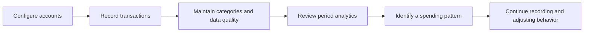

# Product Metrics Framework

## 1. Product Objective

The proposed product objective is to help an individual maintain a sufficiently complete and correctly classified personal ledger to understand spending patterns and make informed decisions.

The current application stores product-domain data but does not implement a product analytics SDK, event table, DAU/MAU calculation, funnels, retention reports, or experimentation framework. Every KPI below is a proposal unless marked **currently derivable**.

## 2. User Value Proposition

The intended value loop is:



The application directly implements A–D. Behavioral change and ongoing value are assumptions that require research and measurement.

## 3. Proposed North Star Metric

**Weekly users with an analysis-ready ledger**

Proposed definition: distinct users in a week who have recorded or updated financial data, meet defined completeness/quality thresholds, and view analytics.

This metric combines activity with data readiness and value consumption. It requires event tracking and quality rules that are not implemented.

## 4. Activation Metrics

| Metric | Definition | Formula | Required events/data | Tracking status |
|---|---|---|---|---|
| Account setup rate | New users creating at least one account | users with `account_created` / new authenticated users | auth user creation, `account_created` | Requires events |
| First-ledger-entry rate | New users adding first non-transfer transaction | users with `transaction_added` / new users | user creation, transaction insert | Partly derivable from DB; cohort event needed |
| First-analysis rate | New users reaching analytics after adding data | users with `analytics_viewed` after first entry / new users | ordered UI events | Not tracked |
| Time to first value | Time from first session to first meaningful analytics view | median timestamp difference | `session_started`, `transaction_added`, `analytics_viewed` | Not tracked |

## 5. Engagement Metrics

| Metric | Definition | Formula | Required events/data | Tracking status |
|---|---|---|---|---|
| Weekly active ledger users | Users adding, editing, or deleting a transaction in week | distinct users with ledger mutation | mutation events or audit table | Partly inferable from `created_at`; edits/deletes not observable |
| Transactions per active user | Ledger-entry frequency | transaction additions / active ledger users | `transaction_added` | New inserts partly derivable |
| Analytics adoption | Ledger-active users who view analytics | users with `analytics_viewed` / active ledger users | UI view event | Not tracked |
| Category drill-down use | Analytics viewers selecting a category | users with `category_drilldown_viewed` / analytics viewers | UI events | Not tracked |
| Export adoption | Active users exporting JSON | users with `data_exported` / active users | export event | Not tracked |

## 6. Retention Metrics

| Metric | Definition | Formula | Required events/data | Tracking status |
|---|---|---|---|---|
| Week-1 retained ledger users | Activated users with ledger activity in following week | returning activated users / activated cohort | user/cohort and activity events | Not tracked |
| Four-week retention | Activated users active in week four | week-4 active / activated cohort | longitudinal events | Not tracked |
| Recording streak | Consecutive weeks with at least one ledger action | max consecutive active weeks | timestamped mutation events | Not tracked |
| Dormant-user return | Inactive users resuming ledger activity | returned users / dormant users | session/activity history | Not tracked |

## 7. Feature Adoption Metrics

| Metric | Definition | Formula | Required events/data | Tracking status |
|---|---|---|---|---|
| Multi-account adoption | Active users with two or more accounts | users with account count ≥ 2 / active users | `finance_accounts` | Currently derivable |
| Multi-currency adoption | Active users with more than one account currency | users with currency count > 1 / active users | accounts | Currently derivable |
| Subcategory adoption | Users assigning at least one subcategory | users with categorized transaction using subcategory / active users | transactions | Currently derivable |
| Transfer adoption | Users recording transfer activity | users with transfer record / active users | transactions | Currently derivable, but double-leg records need deduplication |
| AI report activation | Users enabling AI and storing a key | enabled eligible profiles / active users | profiles + active-user definition | Currently derivable with access controls |
| AI report generation | Eligible users receiving/generating reports | users with report / eligible users | profiles + `ai_reports` | Currently derivable |

## 8. Data Quality Metrics

| Metric | Definition | Formula | Required events/data | Tracking status |
|---|---|---|---|---|
| Categorization completeness | Non-transfer transactions with valid root category | valid categorized records / non-transfer records | transactions + categories | Currently derivable |
| EUR normalization completeness | Records with `amount_eur` | non-null `amount_eur` / transactions | transactions | Currently derivable |
| Balance reconciliation rate | Accounts within tolerance of confirmed/derived balance | reconciled accounts / checked accounts | baseline balance, ledger, confirmations | Not available |
| Orphan-reference rate | Records referencing missing account/category | orphaned records / records | database joins | Derivable if constraints permit or fail |
| Suspected duplicate rate | Records matching duplicate rule | suspected duplicates / imported+manual records | import metadata/fingerprint | Not implemented |
| Fallback-rate usage | Transactions converted using fallback | fallback conversions / converted transactions | rate provenance | Not captured |
| Stale-EUR rate | Edited records whose EUR value no longer matches amount/rate rule | stale records / edited records | audit/rate provenance | Not measurable |

## 9. AI Report Metrics

| Metric | Definition | Formula | Required events/data | Tracking status |
|---|---|---|---|---|
| Report success rate | Successful report generations | reports stored / generation attempts | attempt/result events | Success rows exist; failed attempts not stored |
| Report latency | Time from request to response | response time distribution | server telemetry | Not tracked |
| Useful-report rate | Reports rated useful | positive ratings / rated reports | `ai_report_rated` | Not implemented |
| Recommendation action rate | Users recording an intended action from report | action events / viewed reports | report view/action events | Not implemented |
| Provider cost per active AI user | xAI usage cost per AI user | provider cost / AI-active users | token/cost logs | Not tracked |
| Privacy consent coverage | Report users with current consent | consented AI users / AI users | consent version data | Not implemented |

## 10. Product Funnel

Proposed funnel:

```text
Existing user signs in
→ creates first account
→ records first non-transfer transaction
→ records enough data for a selected period
→ views analytics
→ returns and records data in a later week
→ optionally enables and views an AI report
```

Suggested events:

- `sign_in_completed`
- `account_created`
- `transaction_added`
- `transaction_edited`
- `transaction_deleted`
- `transfer_created`
- `analytics_viewed`
- `category_drilldown_viewed`
- `data_exported`
- `ai_report_enabled`
- `ai_report_generation_requested`
- `ai_report_generated`
- `ai_report_viewed`
- `ai_report_rated`

These events are proposals and are not present in the code.

## 11. Potential Experiments

| Hypothesis | Experiment | Primary metric | Guardrail |
|---|---|---|---|
| Faster setup improves activation. | Guided first-account and first-entry checklist vs current setup. | First-analysis rate | Setup abandonment, error rate |
| Inline uncategorized review improves analysis quality. | Prompt to resolve uncategorized items before analytics. | Categorization completeness | Time to analytics, dismissals |
| Import preview increases ledger coverage. | Prototype validated CSV preview vs manual-only entry. | Analysis-ready ledger rate | Duplicate/error rate |
| Clearer rate provenance increases trust. | Show rate source/time and fallback indicator. | Analytics trust rating | Task completion time |
| Structured AI output is more useful. | Action cards vs free-text report. | Useful-report rate | Generation failure, opt-out |

Experiments require consent-aware assignment, event definitions, minimum sample planning, and safeguards against using sensitive financial values unnecessarily.

## 12. Measurement Limitations

- No event instrumentation or analytics warehouse exists.
- The application has no sign-up flow, so acquisition and registration conversion cannot be measured from this repository.
- Transaction `created_at` cannot represent edits, deletions, views, or active sessions.
- Transfers create two records, which can inflate naive transaction counts.
- Cron failures are returned in a response but not persisted as attempt records.
- Data completeness cannot be assumed from activity volume.
- No user timezone, experiment assignment, consent version, or device/session model exists.
- Product KPIs must avoid sending raw financial amounts to third-party analytics unless explicitly justified and consented.

The recommended first measurement step is a small, privacy-conscious event model with stable user pseudonyms, server-validated events for financial mutations, view events for value consumption, and explicit data-quality indicators.
