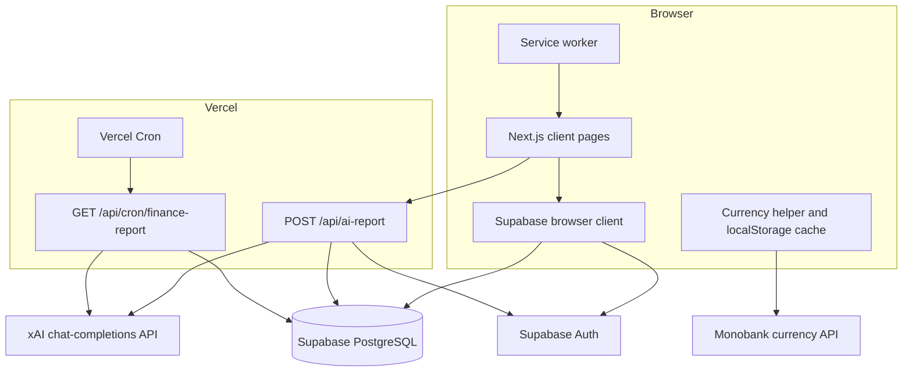
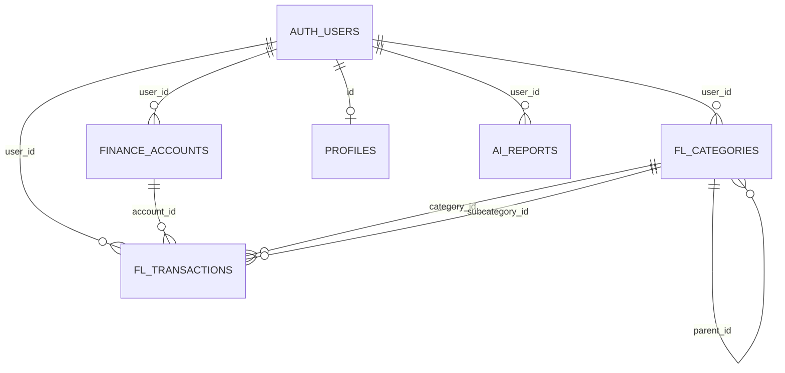
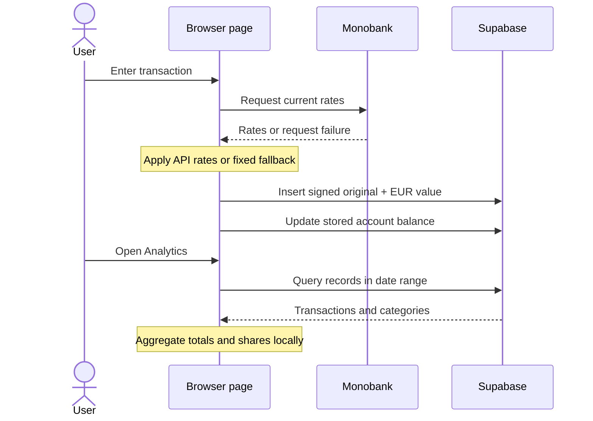

# System Overview

## 1. System Purpose

FlowLedger is a mobile-first personal-finance MVP. It stores user-owned accounts, categories, and transactions in Supabase, calculates descriptive financial analytics in the browser, and can generate short xAI/Grok reports from recent category totals.

## 2. Architecture Overview

## 3. Component Responsibilities

| Component | Responsibility |
|---|---|
| Login page | Existing-user password authentication |
| Home page | Included-account EUR total and recent transaction view |
| Add page | Manual expense/income/transfer creation and balance updates |
| Transactions page | Pagination, client filtering, detail, edit, and deletion |
| Analytics page | Date-range queries and category/subcategory aggregation |
| Settings page | Accounts, categories, JSON export, AI configuration/report display, sign-out |
| `lib/monobank.ts` | Currency retrieval, one-hour browser cache, fallback, conversion |
| `lib/ai-report.ts` | Recent expense aggregation, xAI request, report persistence |
| Supabase clients | Browser/session-bound data access and server session access |
| Cron route | Service-role processing for enabled profiles |
| Service worker | Pre-cache of root/manifest/icons; cache-first lookup for those assets |

## 4. Technology Stack

- Next.js 14.2 App Router, React 18, TypeScript 5.9
- Tailwind CSS, Base UI, Lucide React
- Supabase Auth and Supabase JavaScript/SSR clients
- Supabase-hosted PostgreSQL (platform fact; schema absent from repository)
- date-fns for period calculations
- custom SVG donut chart; Recharts is installed but not used by active pages
- Monobank public currency endpoint
- xAI chat-completions endpoint with `grok-3-mini`
- Vercel hosting and cron
- Web App Manifest and service worker

## 5. Frontend Architecture

All active feature pages are client components. Each creates a Supabase browser client and performs direct queries. State is local React state; there is no global store. The bottom tab bar links `/home`, `/add`, `/transactions`, `/analytics`, and `/settings`.

The root route redirects to `/home`; authenticated pages check `auth.getUser` after loading and route missing users to `/login`. This provides a user flow, not a server-enforced route boundary.

## 6. Backend Architecture

Only two application API routes exist:

- manual AI report generation with the caller's Supabase session;
- scheduled report generation with a server-only Supabase service role.

Account, category, transaction, analytics, profile, and export operations go directly from browser to Supabase.

## 7. Authentication

Supabase email/password sign-in is implemented. Browser and server clients use the public Supabase URL and anon key; the server client forwards cookies. The report API calls `auth.getUser` before querying the caller's profile.

No registration, password recovery, email verification UI, middleware, role model, or administrative UI exists. Authorization for direct database access depends on Supabase RLS, which cannot be verified from this repository.

## 8. Database Integration

The following table names and fields are inferred from queries and TypeScript types. Constraints, defaults, indexes, triggers, and RLS are unverified.

### Inferred entities

| Entity | Observed fields/usage |
|---|---|
| `finance_accounts` | `id`, `user_id`, name/icon/currency, `current_balance`, savings/total flags, sort order, created time |
| `fl_categories` | `id`, `user_id`, name/icon/color/type, self-referencing `parent_id`, sort order, created time |
| `fl_transactions` | ownership/account/category references, signed original amount/currency, `amount_eur`, description/date, transfer flag, receipt URL, source, created time |
| `profiles` | `id`, `grok_api_key`, `ai_report_enabled` |
| `ai_reports` | `user_id`, week bounds, JSON report/summary, generated timestamp |
| `fl_budgets` | TypeScript interface only; deployed table is unverified |

### Access patterns

- accounts/categories by `user_id`, ordered by `sort_order`;
- transactions by `user_id`, ordered by date/creation time, optionally ranged by date and paginated;
- latest AI report by `user_id` and descending generation time;
- profile by authenticated user ID;
- enabled profiles scanned by cron;
- updates/deletes commonly by entity ID only, relying on RLS for ownership enforcement.

## 9. Data Flow

## 10. API Overview

| Method | Endpoint | Purpose | Authentication | Implementation file |
|---|---|---|---|---|
| POST | `/api/ai-report` | Generate and persist current user's report | Supabase session via `auth.getUser` | `app/api/ai-report/route.ts` |
| GET | `/api/cron/finance-report` | Generate reports for enabled profiles | Exact bearer `CRON_SECRET`; service role for DB | `app/api/cron/finance-report/route.ts` |

There is no `/api/currency` route, although the unused `lib/hooks/useCurrency.ts` attempts to call one.

## 11. External Integrations

### Supabase

Provides authentication and persistence. Most reads/writes are initiated directly from the browser. Repository-visible ownership filters are not a substitute for verified RLS.

### Monobank

The browser requests `https://api.monobank.ua/bank/currency`, finds EUR/UAH and USD/UAH sell or cross rates, and derives UAH-to-EUR and USD-to-EUR factors. Values are cached in `localStorage` for one hour. Fixed rates are used on failure.

### xAI/Grok

The server sends recent total spending and category/subcategory totals to the xAI chat-completions API. Transaction descriptions are queried but not included in the prompt. The response text and numeric summary are stored in `ai_reports`.

## 12. Scheduled Jobs

`vercel.json` schedules `/api/cron/finance-report` with `0 8 * * 1`. The route validates `CRON_SECRET`, creates a service-role Supabase client, loads enabled profiles, and processes them concurrently with `Promise.allSettled`.

The repository does not define timezone behavior, execution timeout handling, concurrency controls, retry policy, idempotency, or duplicate-report prevention.

## 13. Error Handling

- Currency API failures fall back to fixed values.
- Authentication and report errors are surfaced as JSON/toasts.
- Cron isolates per-profile failures.
- Most client-side Supabase writes ignore error objects and continue with success UI.
- Analytics and list queries often treat query failure as empty data.
- No centralized logging, monitoring, retry abstraction, or error boundary is present.

## 14. Security

### Observed protections

- local environment files and private-key patterns are ignored;
- service role is referenced only by a server route;
- cron route requires a bearer secret;
- manual report route validates the Supabase user;
- read queries generally filter by authenticated `user_id`.

### Risks and unverified controls

- RLS and database grants are not included.
- Many mutations use only `.eq("id", ...)` and therefore depend entirely on RLS.
- Client-side redirects do not protect server-rendered route content or database access.
- `grok_api_key` is stored in `profiles` and loaded into the browser.
- Service-role cron bypasses RLS and can read all enabled profile keys/financial aggregates.
- Aggregate financial data is disclosed to xAI during report generation.
- No rate limiting, explicit origin/CSRF check, encryption scheme, audit log, retention policy, or deletion workflow is implemented.

## 15. Deployment

The repository is configured for Next.js deployment to Vercel. The public URL was verified to render the sign-in page. Runtime functionality beyond login requires external Supabase schema/policies, configured environment variables, existing users, and optional xAI access.

PWA files are served from `public/`; the service worker pre-caches the root URL, manifest, and icons. Supabase and Monobank requests explicitly use network access and no offline mutation queue exists.

## 16. Technical Limitations

- No SQL migrations or environment-independent setup.
- Non-atomic balance and ledger mutations.
- Transfer pairs are unlinked and cross-currency logic is incorrect for target accounts.
- `amount_eur` becomes stale when amounts are edited.
- Filters run against loaded pages only.
- Category chart excludes uncategorized expenses while headline total includes them.
- Account balances are editable snapshots, not derived/reconciled ledger balances.
- No import, budgets, push delivery, or full offline operation.
- Unused `lib/currency.ts` and `lib/hooks/useCurrency.ts` duplicate/contradict active currency logic.
- No automated tests or product-event instrumentation.
