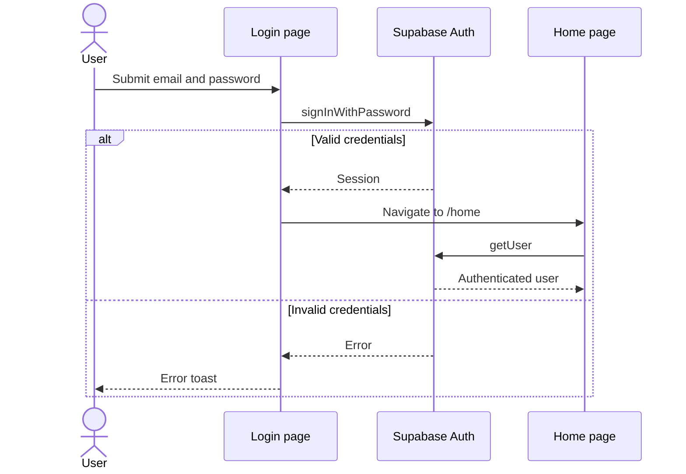
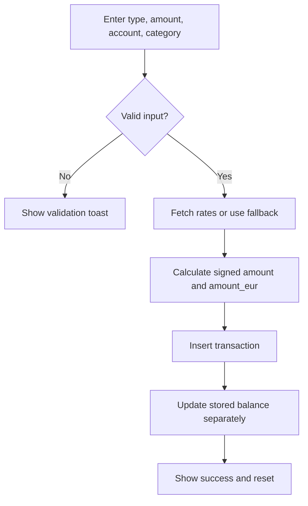
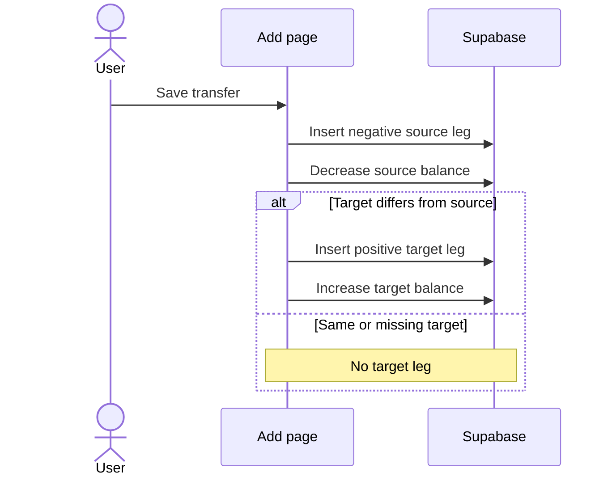
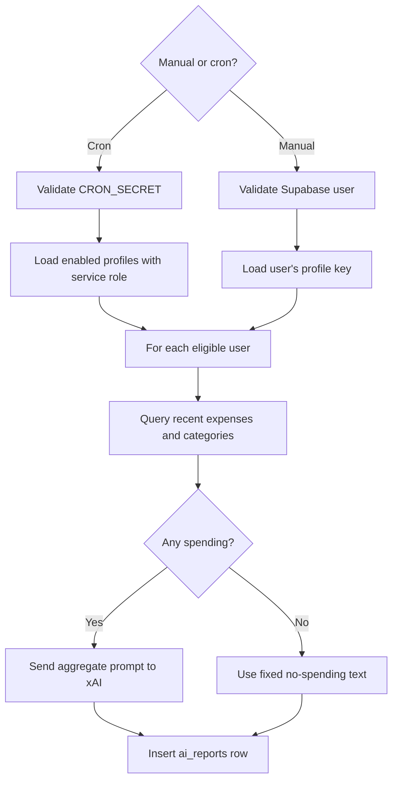

# User Workflows

## 1. Authentication

**Goal:** access an existing user's finance workspace.  
**Actor:** unauthenticated visitor.  
**Preconditions:** a Supabase password user already exists.  
**Trigger:** visitor submits email and password on `/login`.

### Main flow

1. The client calls `supabase.auth.signInWithPassword`.
2. Supabase creates the authenticated session.
3. The client navigates to `/home`.
4. Each tab page calls `auth.getUser`; if no user is returned, it navigates back to `/login`.

### Alternatives and errors

- Empty email/password results in no request and no validation message.
- Supabase authentication errors appear in a toast.
- There is no sign-up or password-recovery flow.
- Protection is client-side; no middleware or server layout guard exists.

**Postcondition:** the browser has a Supabase session.  
**Evidence:** `app/login/page.tsx`; page-level `load` functions; settings sign-out.

## 2. Create and Maintain a Financial Account

**Goal:** add an account used for balances and transactions.  
**Actor:** authenticated user.  
**Preconditions:** active session and expected database table/RLS.  
**Trigger:** user opens Settings > Accounts and chooses Add account.

### Main flow

1. Choose icon and EUR, UAH, or USD.
2. Enter account name and starting balance; optionally mark it as savings.
3. The browser inserts `finance_accounts` with `include_in_total = true`.
4. Settings reloads the user's accounts.
5. The account becomes available in home totals and transaction entry.

### Alternatives and errors

- Empty account name disables submission.
- Balance parse failure becomes `0`, not an error.
- The user can edit metadata/balance, toggle total inclusion, or delete the account.
- Supabase mutation errors are not checked by these handlers.
- Deletion says transactions remain; actual foreign-key behavior is unverified.

**Postcondition:** account state is stored if the mutation succeeds.  
**Evidence:** `addAccount`, `saveEditAccount`, `toggleIncludeInTotal`, `deleteAccount` in `app/(tabs)/settings/page.tsx`.

## 3. Add Expense or Income

**Goal:** record a classified financial event.  
**Actor:** authenticated user.  
**Preconditions:** at least one account and matching root category.  
**Trigger:** user submits the Add form.

### Main flow

1. Select expense or income.
2. Enter amount and select an account; currency follows the account.
3. Select a root category and optional subcategory; optionally add a note.
4. Retrieve Monobank rates or fixed fallback rates.
5. Convert the magnitude to EUR and apply the sign.
6. Insert an `fl_transactions` record with `source = manual`.
7. Separately add the signed original-currency amount to `current_balance`.
8. Reset the form and show a success toast.

### Alternatives and errors

- Invalid/zero amount, missing category, or missing account blocks submission.
- A category or subcategory can be created inline.
- Database errors are ignored; the balance update can succeed when insert fails or vice versa.

**Postcondition:** transaction and balance should reflect the event, but consistency is not guaranteed atomically.  
**Evidence:** `app/(tabs)/add/page.tsx`, `save`, `createCategory`, `createAndSelectSubcat`; `lib/monobank.ts`.

## 4. Create a Transfer

**Goal:** move value between two stored accounts.  
**Actor:** authenticated user.  
**Preconditions:** a source account; a different target account is required for a complete two-leg transfer but is not validated.  
**Trigger:** user selects Transfer and saves.

### Main flow

1. Insert a negative source transaction with `is_transfer = true`.
2. Decrease the source stored balance.
3. If the target is present and differs from the source, insert a positive target transaction.
4. Increase the target stored balance.

### Limitations and errors

- Four separate operations are not transactional.
- Legs have no transfer identifier.
- Target amount and currency reuse the source amount/currency, even when target account currency differs.
- Selecting the same source and target produces only a negative source record.
- Editing or deleting one leg does not update the other.

**Evidence:** transfer branch of `save` in `app/(tabs)/add/page.tsx`.

## 5. View, Filter, Edit, and Delete Transactions

**Goal:** inspect and correct ledger records.  
**Actor:** authenticated user.  
**Preconditions:** stored transactions.  
**Trigger:** user opens Transactions.

### Main flow

1. Load categories/accounts and the first 50 transactions, ordered by date and creation time.
2. Optionally load more pages.
3. Filter the loaded array by type and current week/month; sort it in the browser.
4. Open details.
5. Edit selected fields or delete the record.
6. Apply an amount delta or reversal to the stored account balance, then mutate the transaction.

### Alternatives and errors

- Filters do not query the database and cannot match unloaded records.
- Editing does not recalculate `amount_eur`.
- Transfer counterpart records are not synchronized.
- Mutation errors are not checked.

**Postcondition:** the selected record is changed/deleted if the database request succeeds.  
**Evidence:** `app/(tabs)/transactions/page.tsx`, `load`, `applyFilters`, `saveEdit`, `deleteTx`.

## 6. View Financial Analytics

**Goal:** compare income and expense composition for a period.  
**Actor:** authenticated user.  
**Preconditions:** transaction records with valid dates.  
**Trigger:** user opens Analytics or changes period/granularity.

### Main flow

1. Calculate an inclusive date interval for day/week/month/year using the client date.
2. Query user records in range with `is_transfer = false`.
3. Load categories and exchange rates.
4. Split records by amount sign.
5. Sum absolute EUR values for spent and income totals.
6. Group categorized expenses by root category and calculate shares.
7. Allow drill-down to subcategories.

### Alternatives and errors

- Empty results display an empty-state message.
- Missing `amount_eur` is converted at the current/fallback rate.
- Missing categories are omitted from the root chart but remain in total spent.
- Query errors are treated like empty arrays; no error state is shown.

**Evidence:** `app/(tabs)/analytics/page.tsx`; `components/DonutChart.tsx`.

## 7. Export Financial Data

**Goal:** obtain a portable transaction snapshot.  
**Actor:** authenticated user.  
**Preconditions:** active session.  
**Trigger:** Settings > Export all data (JSON).

### Main flow

1. Query all user transactions, categories, and accounts.
2. Replace category/account IDs with names in each exported row.
3. Create a JSON blob and initiate a dated file download.

### Alternatives and errors

- No error or empty-export warning is displayed.
- The output is a flattened transaction list, not a full relational backup.
- No CSV/Excel option or import/recovery workflow exists.

**Evidence:** `exportJSON` in settings.

## 8. Generate an AI Report

**Goal:** receive a short commentary on recent spending.  
**Actors:** authenticated user or protected cron route.  
**Preconditions:** stored Grok key; for scheduled generation, `ai_report_enabled = true`.  
**Trigger:** Generate report now or Monday cron schedule.

### Main flow

1. Resolve the user(s) and Grok key(s).
2. Query negative, non-transfer transactions in the recent date window and user categories.
3. Aggregate absolute EUR-or-original values by root/subcategory.
4. If spending exists, send total and breakdown to xAI; otherwise use a fixed no-spending message.
5. Insert an `ai_reports` row and return the result.

### Alternatives and errors

- Missing session returns 401; missing key returns 400.
- Supabase or xAI failure returns 500 for manual requests.
- Cron uses `Promise.allSettled` and reports failures.
- Manual generation does not require `ai_report_enabled`.
- Push delivery is not implemented.

**Evidence:** `app/api/ai-report/route.ts`; `app/api/cron/finance-report/route.ts`; `lib/ai-report.ts`; `vercel.json`.

## 9. Workflows Not Present

No implemented workflow was found for registration, password recovery, Excel/CSV import, budgets, receipt upload, push notification delivery, account reconciliation, or reliable offline finance access.
